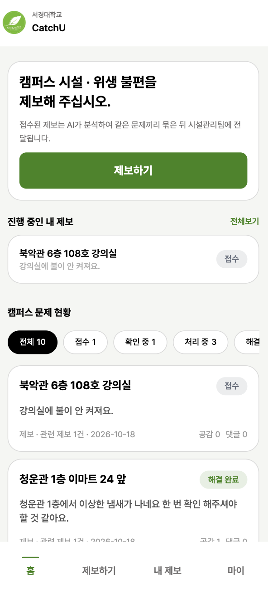
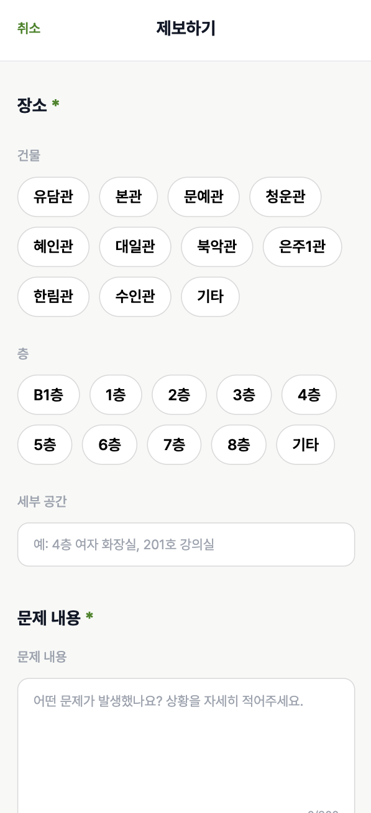

<div align="left">

# 🏫 Catch-U

### 불편이 문제가 되기 전에, 캠퍼스의 이상 신호를 먼저 발견하다.

**AI 기반 캠퍼스 문제 탐지 및 관리 서비스**
학생들의 작은 불편 제보를 연결하여 캠퍼스의 반복되는 문제를 발견하고, 관리자가 신속하게 대응할 수 있도록 돕는 서비스

<br/>

[🌐 서비스 바로가기](https://catch-u.netlify.app)

<br/>





<br/>

**학생 홈 · 제보 등록 · 관리자 대시보드**

</div>

## 📖 01. 서비스 소개

**Catch-U**는 학생들이 캠퍼스에서 겪는 시설·위생 관련 불편 사항을 제보하면, AI가 제보 내용을 분석하여 유사한 문제를 연결하고 이상징후를 탐지하는 서비스입니다.

같은 장소에서 발생하는 여러 제보를 개별적인 문제로만 처리하는 것이 아니라, **하나의 문제로 연결하여 반복되는 불편을 발견**합니다.

관리자는 AI 분석 결과를 바탕으로 점검이 필요한 문제를 확인하고 처리할 수 있으며, 학생은 자신이 등록한 제보의 처리 상태와 해결 결과를 확인할 수 있습니다.

> **단순한 불편 신고를 넘어, AI를 활용해 캠퍼스의 문제를 조기에 발견하고 해결하는 서비스**

## 💡 02. 기획 배경 및 문제 정의

### 🔍 Problem

캠퍼스에서는 시설 고장, 위생 문제 등 다양한 불편 사항이 발생합니다.

하지만 이러한 문제는 개별적으로 접수되거나 전달되어, 같은 장소에서 비슷한 문제가 반복되고 있어도 이를 하나의 문제로 파악하기 어렵습니다.

또한 학생들은 제보 이후 문제가 어떻게 처리되고 있는지 확인하기 어렵고, 관리자는 여러 제보 중 어떤 문제를 우선적으로 점검해야 하는지 판단하기 어려울 수 있습니다.

### 🎯 Solution

Catch-U는 다음과 같은 방식으로 문제를 해결하고자 합니다.

| 문제점 | Catch-U의 해결 방식 |
| --- | --- |
| 불편 사항이 개별적으로 접수됨 | AI가 유사한 제보를 분석하고 연결 |
| 반복되는 문제를 파악하기 어려움 | 장소·문제 유형을 기반으로 이상징후 탐지 |
| 문제의 우선순위를 판단하기 어려움 | 점검 필요도와 심각도 정보 제공 |
| 제보 이후 처리 과정을 확인하기 어려움 | 제보 처리 상태 및 해결 결과 제공 |

## ✨ 03. 핵심 기능

### 👩‍🎓 학생 기능

| 기능 | 설명 |
| --- | --- |
| 📝 캠퍼스 불편 제보 | 건물·층·세부 장소를 선택하고 문제 내용과 사진 등록 |
| 🏠 캠퍼스 문제 현황 | 학교 내 접수된 문제와 처리 상태 확인 |
| 🔍 문제 상세 조회 | 문제 내용, 관련 제보 및 처리 상태 확인 |
| ❤️ 공감 및 댓글 | 다른 학생의 제보에 공감하거나 의견 작성 |
| 📋 내 제보 관리 | 본인이 등록한 제보 목록과 진행 상황 확인 |
| ✅ 해결 결과 확인 | 관리자가 처리한 문제의 해결 내용 확인 |

### 👨‍💼 관리자 기능

| 기능 | 설명 |
| --- | --- |
| 📊 문제 현황 대시보드 | 전체 문제 및 처리 상태별 현황 확인 |
| 🚨 AI 이상징후 탐지 | 반복되는 문제의 이상징후 및 점검 필요도 확인 |
| 🤖 AI 분석 정보 | 문제 유형, 심각도 및 분석 결과 확인 |
| 🔗 관련 제보 조회 | 동일한 문제로 연결된 제보 목록 확인 |
| 🔄 처리 상태 관리 | 문제의 처리 진행 상태 변경 |
| ✅ 해결 결과 등록 | 문제 해결 내용 및 처리 결과 등록 |

## 📱 04. 주요 서비스 화면

### 01. 학생 홈

학생은 홈 화면에서 캠퍼스의 불편 사항을 제보하고, 본인이 등록한 제보 및 전체 문제 현황을 확인할 수 있습니다.

- 캠퍼스 불편 사항 제보
- 진행 중인 내 제보 확인
- 캠퍼스 문제 현황 조회
- 처리 상태별 문제 필터링
- 문제별 관련 제보, 공감 및 댓글 확인

<div align="left">
  
</div>

### 02. 제보 등록

학생은 문제가 발생한 위치와 상황을 입력하여 새로운 제보를 등록할 수 있습니다.

- 건물 및 층 선택
- 세부 공간 입력
- 문제 상황 작성
- 사진 첨부 및 제보 등록

<div align="left">
  
</div>

### 03. 관리자 대시보드

관리자는 전체 문제 현황과 AI가 분석한 이상징후를 확인하여 점검이 필요한 문제를 파악할 수 있습니다.

- 전체·확인 중·처리 중·해결 완료 현황
- AI 기반 점검 필요도 점수
- 문제 유형 및 심각도
- 최근 접수된 제보
- 문제 상세 및 관련 제보 확인

<div align="left">
  
</div>

## 🔄 05. 서비스 동작 흐름

```text
                  👩‍🎓 학생
                     │
                     ▼
              캠퍼스 불편 제보
                     │
                     ▼
              제보 데이터 저장
                     │
                     ▼
                🤖 AI 분석
                     │
           ┌─────────┴─────────┐
           ▼                   ▼
      제보 내용 분석       유사 제보 연결
           │                   │
           └─────────┬─────────┘
                     ▼
                이상징후 탐지
                     │
                     ▼
                👨‍💼 관리자
                     │
                     ▼
           문제 및 AI 분석 결과 확인
                     │
                     ▼
              문제 처리 및 해결
                     │
                     ▼
               👩‍🎓 학생
                     │
                     ▼
           처리 상태 및 결과 확인
```

### 🔍 AI 분석 과정

**① 제보 분석**

학생이 작성한 제보 내용을 분석하여 장소, 시설 및 문제 유형 등의 정보를 파악합니다.

**② 유사 제보 연결**

같은 장소에서 발생한 유사한 문제를 연결하여 하나의 문제 그룹으로 관리합니다.

**③ 이상징후 탐지**

연결된 제보와 문제 정보를 바탕으로 점검이 필요한 이상징후를 탐지합니다.

**④ 관리자 대응**

관리자는 점검 필요도와 AI 분석 결과를 참고하여 문제를 확인하고 처리합니다.

## 🛠️ 06. 기술 스택

### 💻 Frontend

| 기술 | 사용 목적 |
| --- | --- |
| React | 컴포넌트 기반 사용자 인터페이스 구현 |
| TypeScript | 타입 안정성 확보 |
| Vite | 개발 환경 구성 및 빌드 |
| Tailwind CSS | UI 스타일링 및 반응형 디자인 |
| Zustand | 전역 상태 및 인증 상태 관리 |
| React Router | 페이지 라우팅 |
| Axios | 백엔드 REST API 통신 |
| Netlify | 프론트엔드 배포 |

### ⚙️ Backend

| 기술 | 사용 목적 |
| --- | --- |
| Java | 백엔드 애플리케이션 개발 |
| Spring Boot | REST API 서버 구축 |
| MySQL | 사용자·제보·문제 데이터 관리 |
| Docker | 애플리케이션 컨테이너화 |
| Gabia | 서버 인프라 및 배포 환경 운영 |

### 🤖 AI

| 기술 | 사용 목적 |
| --- | --- |
| Google Gemini API | 제보 내용 분석 및 유사 문제 탐지 |

### 🎨 Collaboration

| 기술 | 사용 목적 |
| --- | --- |
| Git | 버전 관리 |
| GitHub | 코드 관리 및 협업 |
| Figma | UI/UX 디자인 및 화면 설계 |

## 🏗️ 07. 시스템 아키텍처

```text
                 👩‍🎓 학생 / 👨‍💼 관리자
                          │
                          ▼
               ┌─────────────────────┐
               │      Frontend       │
               │ React + TypeScript  │
               │        Vite         │
               │       Netlify       │
               └──────────┬──────────┘
                          │
                       REST API
                          │
                          ▼
               ┌─────────────────────┐
               │       Backend       │
               │   Java / Spring     │
               │        Boot         │
               │   Docker / Gabia    │
               └──────────┬──────────┘
                          │
                ┌─────────┴─────────┐
                ▼                   ▼
       ┌────────────────┐  ┌────────────────┐
       │     MySQL      │  │ Google Gemini  │
       │                │  │      API       │
       │  데이터 저장   │  │   AI 분석      │
       └────────────────┘  └────────────────┘
```

### 시스템 구성

- **Frontend:** 학생 및 관리자 웹 화면 구현, 사용자 입력 처리, API 통신
- **Backend:** 사용자 인증, 제보 및 문제 데이터 관리, AI API 연동
- **Database:** 사용자·제보·문제 및 처리 결과 데이터 저장
- **AI:** 제보 내용 분석 및 유사 문제 탐지
- **Deployment:** Netlify와 Docker 기반 배포 환경 활용

## 👥 08. 팀원 소개

| 이름 | 역할 | 담당 |
| --- | --- | --- |
| 최가은 | PM | 프로젝트 기획 및 일정 관리, 기능 정의 |
| 김나래 | UI/UX Designer | UI/UX 디자인 및 화면 설계 |
| 홍윤지 | Frontend | 학생·관리자 UI 구현 및 API 연동 |
| 이주희 | Backend & AI | 서버 개발, 데이터베이스 구축 및 AI 분석 기능 개발 |

## 🔗 09. 프로젝트 링크

| 구분 | 링크 |
| --- | --- |
| 🌐 Web Service | [Catch-U 바로가기](https://catch-u.netlify.app) |
| 💻 Frontend | [Frontend Repository](https://github.com/5nel-day1/FE) |
| ⚙️ Backend | [Backend Repository](https://github.com/5nel-day1/BE) |

<div align="left">

### 🏫 Catch-U

**작은 불편을 놓치지 않고, 더 나은 캠퍼스를 만들어 갑니다.**

</div>
